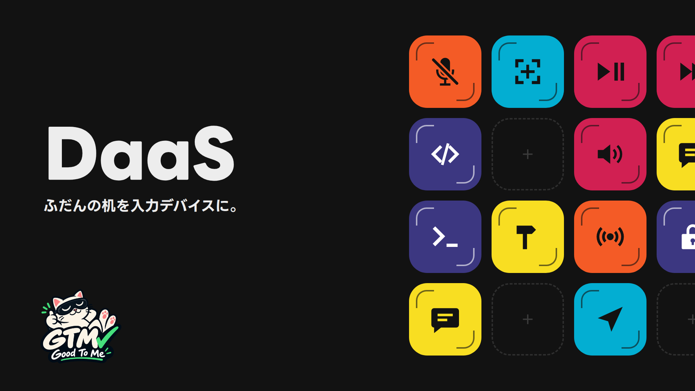
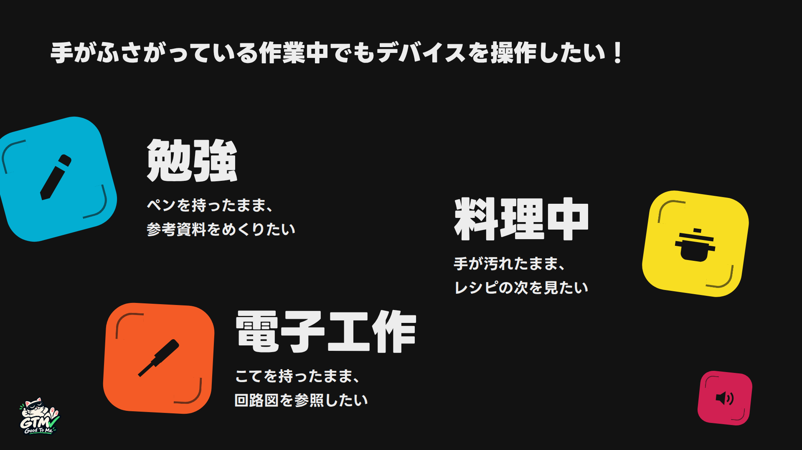
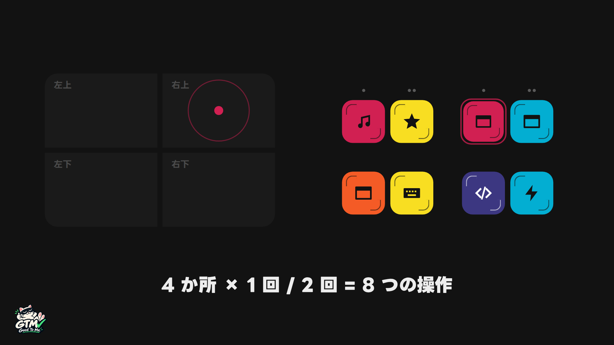
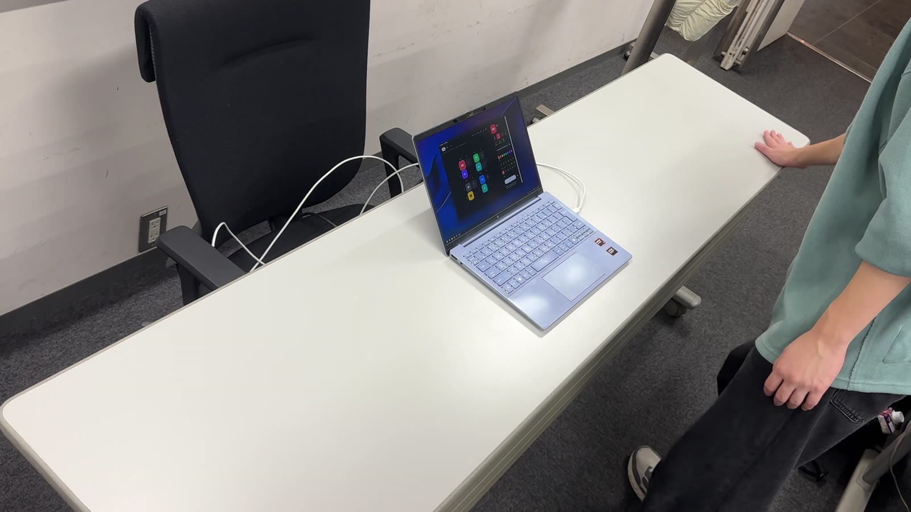
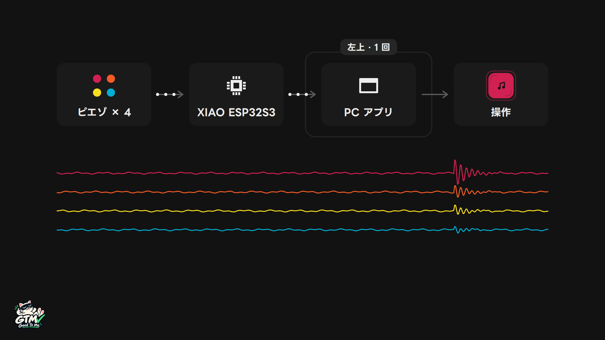
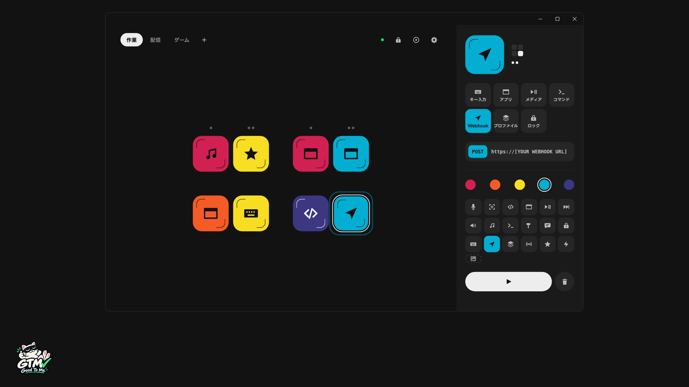

# DaaS

**机を叩くと、API が叩かれる。** ふだんの机を、PC の入力デバイスにします。

[](YOUTUBE_URL)

## 製品概要
### 背景(製品開発のきっかけ、課題等）

手がふさがっている作業の途中で、PC を少しだけ操作したい場面があります。

- 勉強：ペンを持ったまま、参考資料の次のページを開きたい
- 料理：手が汚れたまま、レシピの次の手順を見たい
- 電子工作：はんだごてを持ったまま、回路図を見たい

キーボードやマウスを使うには、手を空けて、きれいにする必要があります。音声操作は、会議中や配信中、騒がしい場所では使いにくいです。

一方で、作業中でも机にはいつも手が届きます。ひじや手の甲で軽く叩くこともできます。そこで、机そのものを入力デバイスにすることにしました。



### 製品説明（具体的な製品の説明）

DaaS（Desktop as a Service）は、机の裏に貼った 4 個のピエゾ（圧電素子）で、机を叩いた振動を拾います。叩いた場所（左上・右上・左下・右下）と回数（1 回・2 回）の組み合わせで 8 つのキーになり、キーごとに割り当てた PC の操作を実行します。





PC 側は Windows に常駐するアプリです。振動を拾う（Sense）、叩いた場所と回数を見分ける（Think）、操作を実行する（Act）の 3 段で動きます。

| 段 | 担当 | すること |
|---|---|---|
| Sense | ピエゾ 4 個 ＋ 入力回路 ＋ XIAO ESP32S3 | 4 ch の振動を毎秒 4000 回読み、生の値を USB シリアルで PC に送る |
| Think | PC アプリの検出器 | 波形から打を切り出し、4 ch の振れ方を机ごとに覚えた型と比べて、場所と回数を決める |
| Act | PC アプリ | そのキーに割り当てた操作を実行する。設定画面を開いていれば、叩かれたキーが光る |



キーに割り当てられる操作は 7 種類です。

| 操作 | 動き |
|---|---|
| キー入力 | ショートカットキーを送る（例：Ctrl+C、スクリーンショット） |
| アプリ | アプリやファイル、URL を開く |
| メディア | 再生・停止、曲送り・曲戻し、音量、マイクのミュート |
| コマンド | コマンドを実行する |
| Webhook | URL に POST する（叩いた場所・回数・時刻を JSON で送る） |
| プロファイル | キーの割り当て一式（作業・配信・ゲームなど）を切り替える |
| ロック | 叩いても何も動かないようにする（ロックのキーだけは動く） |



### 特長
#### 1. ふだんの机が、そのまま 8 つのキーになる

センサーは机の裏に貼るだけで、机の上には何も置きません。叩く場所は机の 4 か所なので、手元を見なくても叩けます。

#### 2. 30 秒ほどのキャリブレーションで、どの机にも合わせられる

振動の伝わり方は、机の材質や大きさ、センサーを貼った位置で変わります。そこで DaaS は最初に、机の 4 か所を 3 回ずつ叩いてもらい、4 ch の振れ方の型を場所ごとに覚えます。型さえ分かれていれば、センサーが領域の真下になくても場所を見分けられる仕組みです。見分けにくい場所があれば、その場でタイルを赤くして叩き直してもらいます。

#### 3. 叩いたら、キー入力から Webhook まで動かせる

ショートカットキーやアプリの起動だけでなく、コマンドや Webhook も割り当てられます。Webhook は叩いた場所・回数・時刻を JSON で POST するので、受け取る側を用意すれば、PC の外のものも机から動かせます。キーの割り当ては、設定画面で操作をキーにドラッグするだけです。

### 解決出来ること

キーボードやマウス、声を使いにくい瞬間に、机を叩くというもう 1 つの入力手段を用意します。

- 手がふさがっている、汚れている作業の途中でも、ひじや手の甲で机を叩いて PC を操作できる（勉強、料理、電子工作）
- 配信やゲームの最中に、手元を見ずに録画やシーンの切り替えを行える
- 会議中や公共の場所など、声を出しにくい場面でも操作できる
- 机の上に操作用の機器を増やさずに、よく使う操作を 8 つ手元に置ける

### 今後の展望

- 机の好きな場所を登録して、4 か所より多くの場所を使えるようにする
- 机にもたれる、物を置くといった、叩く以外の振動との区別を強める
- XIAO ESP32S3 の無線（Wi-Fi・Bluetooth）を使って、PC とのケーブルをなくす
- 叩く場所に触ってわかる目印を付ける、音で結果を返すなど、小さなボタンを押しにくい人にも使いやすくする

### 注力したこと（こだわり等）
* **判定は PC で行う**：マイコンは生の値を送るだけにし、叩いた場所と回数の判定は PC アプリで行います。判定を直すときに、マイコンへの書き込み直しが要りません。
* **実際に叩いたログで採点して決める**：叩き方ごとに生の値を記録する CLI（`tools/tap-collect`）を作り、アプリと同じ判定のコードをそのログで採点しました。しきい値や打の切り出し方は、この点数を比べて決めています。
* **机と同じ並びの画面にする**：設定画面のキーは、机の 4 か所と同じ配置に並べています。叩いたキーは画面で光るので、どこを叩けば何が動くかがすぐ分かります。

## 開発技術
### 活用した技術
#### API・データ
* Win32 `SendInput`（キー入力・メディアキー）
* Windows Core Audio `IAudioEndpointVolume`（マイクのミュート）
* Webhook（HTTP POST、JSON）
* USB シリアル（4 ch の生の値、毎秒 4000 行）

#### フレームワーク・ライブラリ・モジュール
* Electron、electron-vite、TypeScript
* React 19、Tailwind CSS v4、@dnd-kit/core
* serialport、koffi
* Arduino（ESP32 のファーム）

#### デバイス
* Seeed Studio XIAO ESP32S3
* 圧電サウンダー 村田製作所 7BB-27-4L0 × 4
* オペアンプ NJU7043D × 2（入力回路。[回路図](docs/circuit.html)）
* Windows 10 / 11 の PC

### 独自技術
#### ハッカソンで開発した独自機能・技術
* 叩いた場所と回数の検出器（[`app/src/main/protocols/detector.ts`](app/src/main/protocols/detector.ts)、[42569d5](https://github.com/jphacks/tkb_2618/commit/42569d5)）。4 ch の生の値から打を切り出し、場所ごとの型と比べて場所を決めます。同じ場所への 320 ms 以内の 2 打目は、2 回として数えます
* キャリブレーション（[`app/src/shared/calibration.ts`](app/src/shared/calibration.ts)、[`app/src/shared/tap-procedure.ts`](app/src/shared/tap-procedure.ts)、[42569d5](https://github.com/jphacks/tkb_2618/commit/42569d5)）。4 か所 × 3 打から、ch ごとのしきい値と場所ごとの型を作り、見分けにくい場所を見つけます
* 記録と採点のツール（[`tools/tap-collect`](tools/tap-collect)、[6530c8a](https://github.com/jphacks/tkb_2618/commit/6530c8a)）。叩き方ごとの生の値を記録し、アプリの検出器をそのログで採点します
* 生の値を送るファーム（[`firmware/xiao-stream`](firmware/xiao-stream)、[508970c](https://github.com/jphacks/tkb_2618/commit/508970c)）と、それを読むアプリ側のアダプタ（[`app/src/main/protocols/`](app/src/main/protocols/)、[769d0bb](https://github.com/jphacks/tkb_2618/commit/769d0bb)）
* Hack Day 終了時点のコードには、タグ [`hackday-code-freeze`](https://github.com/jphacks/tkb_2618/tree/hackday-code-freeze) を付けています。

## リポジトリの構成

| ディレクトリ | 中身 |
|---|---|
| [`app/`](app/) | PC アプリ（Windows 常駐。Electron ＋ React） |
| [`firmware/xiao-stream/`](firmware/xiao-stream/) | 本番のファーム（Arduino IDE で書き込む） |
| [`tools/tap-collect/`](tools/tap-collect/) | 叩き方ごとの生の値を記録し、検出器を採点する CLI |
| [`docs/`](docs/) | 仕様・プロトコル・回路図・デザイン |

実機がなくても、疑似入力で画面を動かせます。

```powershell
cd app
npm ci
$env:DESKAPI_MOCK = 1; npm run dev
```

開発環境の準備は [`docs/setup.md`](docs/setup.md)、実機での確認は [`docs/hardware-test.md`](docs/hardware-test.md) にあります。

## チーム

Good To ME（JPHACKS 2026 Tokyo B）

## ライセンス

[MIT License](LICENSE)
